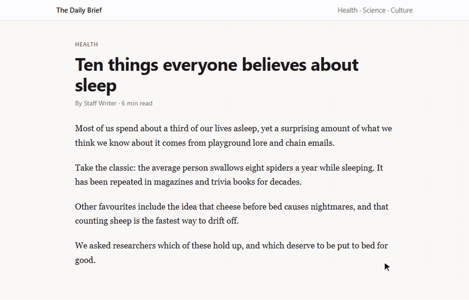

<!-- Copyright 2027 Bodapati Bharat Chandra. All rights reserved. -->
<!-- Licensed under the Apache License, Version 2.0 | SPDX-License-Identifier: Apache-2.0 -->

<p align="center">
  
</p>

<p align="center">
  <a href="https://truvantaai.tech/install"><b>Install</b></a>
  &nbsp;&middot;&nbsp;
  <a href="https://truvantaai.tech">Website</a>
  &nbsp;&middot;&nbsp;
  <a href="#measured-not-claimed">Results</a>
  &nbsp;&middot;&nbsp;
  <a href="docs/ARCHITECTURE.md">Architecture</a>
  &nbsp;&middot;&nbsp;
  <a href="docs/API.md">API</a>
</p>

<p align="center">
  <a href="https://github.com/chandu1234678/FactCheckAI/actions/workflows/ci.yml"></a>
  
  
  
  
</p>

Truvanta is a browser extension that fact-checks what you read, where you read it. Highlight a sentence on any page and a card opens beside it: it searches published fact-checks, news, reference works and research at once, has a language model read what it found, and answers with a verdict that cites each source. Free, open source, and running on free infrastructure end to end.

<p align="center">
  
  <br/>
  <sub>Recorded from the real extension and backend, not a mock-up. Verdict in 5.0 seconds.</sub>
</p>

## Measured, not claimed

Every number below comes from [`backend/eval/run_eval.py`](backend/eval/run_eval.py), which sends {{N}} labelled claims through the same streaming endpoint the card uses and records what a user would see. Measured on {{DATE}}, one claim at a time, fresh cache.

| | |
|---|---|
| **Accuracy when it gives a verdict** | **{{ACC}}%** |
| Says Uncertain | {{UNC}}% |
| Wrong verdict | {{WRONG}}% |
| Found sources | {{SRC}}% |
| Matched a published fact-check | {{FC}}% |
| First source in the card, median (p95) | {{FS50}} s ({{FS95}} s) |
| Verdict, median (p95) | {{V50}} s ({{V95}} s) |

<details>
<summary>By topic, and what the set does and doesn't cover</summary>

{{TOPICS}}

The set is balanced between true and false claims across health, science, history, geography, technology, climate, economics and politics, and limited to settled facts so the labels aren't arguable. It does not yet cover breaking news, non-English claims or claims about specific people, which are harder; [adding claims](CONTRIBUTING.md#good-places-to-start) is one of the most useful contributions. A wrong verdict is counted as worse than "Uncertain": changes that raise accuracy by guessing more are rejected.

Reproduce it:

```bash
cd backend
uvicorn app.main:app --port 8000      # in one terminal
python eval/run_eval.py               # in another; --limit 20 for a quick run
```

</details>

## What it looks like in practice

Real output from the evaluation run, unedited:

{{EXAMPLES}}

## How a check works

<picture>
  <source media="(prefers-color-scheme: light)" srcset="docs/assets/pipeline-light.svg"/>
  
</picture>

1. **Memory.** The claim is embedded (MiniLM on ONNX, about 2 ms) and compared with past checks in pgvector while the search starts. The same claim, checked recently and backed by sources, is answered at once; sources from similar past checks are added to what the model reads. Word order, negations and numbers are checked, because embeddings alone treat "light is faster than sound" and its reverse as the same.
2. **Key terms.** The claim is reduced to what finds evidence: names, numbers, codes and quoted phrases. No AI involved.
3. **Search, in parallel.** Google Fact Check Tools, Google News, Bing News, Wikipedia, PubMed (for health) and web search are queried at once under a 3.5 second cap. The best pages are scraped for the paragraphs that match.
4. **Rank.** Fact-checks first, then research, reference and news; at most two items per outlet, and a story syndicated under several URLs counts once.
5. **Judge.** A language model reads only those numbered passages, cites each statement as `[n]` and marks every source as supporting, refuting or neutral. If its verdict disagrees with its own source judgements, or with a relevant published fact-check, the evidence wins or the answer becomes Uncertain.
6. **No sources found.** If nothing addresses the claim, the model answers from established knowledge, capped at 70% confidence and labelled "No sources found" in the card. For anything recent or unfamiliar it says Uncertain instead.
7. **Stream.** Sources, an early fact-check match and the verdict reach the card as they happen.

The popup's chat runs a deeper check on top: fine-tuned DeBERTa-v3 and RoBERTa classifiers for the language of misinformation, manipulation and SHAP explainability analysis, domain classification and a calibrated decision model that fuses them. Drift detection, claim-velocity tracking and continuous retraining run alongside. The repository also holds hybrid BM25 + vector retrieval with Reciprocal Rank Fusion, a cross-encoder reranker and a nine-node LangGraph workflow, which are not yet on a request path. **[Architecture](docs/ARCHITECTURE.md)** says exactly what runs where, and why.

## What a verdict means

| Verdict | Meaning |
|---|---|
| **True** | The sources found support the claim. |
| **False** | The sources refute it, or a professional fact-checker rated a matching claim false. |
| **Uncertain** | The evidence is mixed, or nothing settles it. Read it as "not settled", not "probably false". |

Confidence reflects how clearly the evidence points one way, not a statistical guarantee. Each source row links to the original, numbered to match the `[n]` citations; low-reliability results are labelled `low trust`. A verdict marked "No sources found" rests on general knowledge only.

## Features

- **In-page card** on any site, with live progress, numbered citations and a follow-up chat that keeps the claim and its evidence as context.
- **Popup** with a full chat, history (reopened chats keep their fact-check cards), saved claims, a dashboard and settings.
- **Shortcuts:** `Ctrl+Shift+U` checks the selection, `Ctrl+Shift+L` the visible page, `Ctrl+Shift+Y` opens the popup. Right-click works too.
- **Accounts** with email or Google sign-in; the card prompts for it and resumes the check afterwards.
- **Resilient by design:** failing sources are rested and retried, a rescue search runs when results are thin, and language models are discovered at runtime and ranked by how they behave, so a retired model or exhausted quota never takes the extension down.
- **Multilingual input**, normalized before searching. Repeat checks are instant.

## Install

1. Download the latest ZIP from the [install page](https://truvantaai.tech/install) and extract it to a folder you'll keep.
2. Open `chrome://extensions` (or `edge://extensions`) and turn on **Developer mode**.
3. Click **Load unpacked** and choose the extracted folder, the one containing `manifest.json`.
4. Pin Truvanta, sign in, and highlight something to check.

Chrome Web Store and Firefox releases are on the roadmap.

## Limitations

- **Coverage depends on what has been published.** Very recent or very local claims may have no sources yet.
- **Answers without sources are weaker.** They are capped, labelled, and the model is told to say Uncertain for anything recent, but a model's memory can still be wrong.
- **Free sources have limits.** News feeds return headlines and snippets, and some sites block scraping.
- **Not every highlight is a claim.** Titles, headings and opinions can't be fact-checked.
- **Cold starts.** The free backend sleeps after 15 idle minutes; the first check after that can take 30 to 60 seconds.

## Development

```bash
cd backend && pip install -r requirements.txt && uvicorn app.main:app --reload --port 8000
python -m pytest tests -q
```

Set `USE_LOCAL_BACKEND = true` in `extension/env.js` and load the `extension` folder unpacked. [CONTRIBUTING.md](CONTRIBUTING.md) has the environment variables, the evaluation workflow and good first contributions; [docs/API.md](docs/API.md) documents the endpoints and the event stream.

## Roadmap

- A local index of published fact-checks for instant matches with no API call
- Small CPU-only models for stance detection, to depend less on hosted language models
- Detecting text that isn't a factual claim before searching
- A larger evaluation set with breaking news and non-English claims, run in CI
- Chrome Web Store and Firefox releases

The longer-term direction is in the [3.0 product plan](docs/PRODUCT_PLAN.md).

## License

Apache License 2.0. See [LICENSE](LICENSE) and [NOTICE](NOTICE). Security reports: [SECURITY.md](SECURITY.md).

Classifier training data: LIAR (Wang, 2017), ISOT Fake News, FakeNewsNet (Shu et al., 2018), daniB2112/fake-news-dataset, WELFake, GonzaloA/fake_news and FEVER v1.0.

```bibtex
@software{truvanta2026,
  title   = {Truvanta: Source-Grounded Fact-Checking in the Browser},
  author  = {Bodapati Bharat Chandra},
  year    = {2026},
  url     = {https://github.com/chandu1234678/FactCheckAI},
  version = {2.6.3},
  license = {Apache-2.0}
}
```
