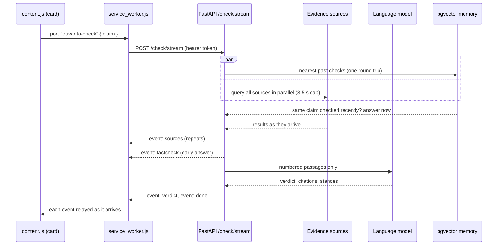
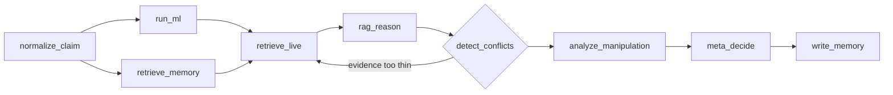

<!-- Copyright 2027 Bodapati Bharat Chandra. All rights reserved. -->
<!-- Licensed under the Apache License, Version 2.0 | SPDX-License-Identifier: Apache-2.0 -->

# Architecture

Three lanes work on every claim: models trained for this project, a persistent memory of past checks with hybrid retrieval, and live evidence from the web. A grounded reasoning step and a calibrated decision model combine them, and every result feeds back into memory and monitoring.

<p align="center">
  
</p>

- [Request path](#request-path)
- [Live evidence](#live-evidence)
- [Own models](#own-models)
- [Persistent memory and RAG](#persistent-memory-and-rag)
- [Agentic workflow](#agentic-workflow)
- [Decision engine](#decision-engine)
- [Analysis modules](#analysis-modules)
- [Components and hosting](#components-and-hosting)
- [Repository layout](#repository-layout)

## Request path



The in-page card never calls the backend directly: requests from a content script carry the website's origin, which the backend's CORS policy rejects. The background worker makes the request and relays each streamed event to the card over a long-lived port. Closing the card cancels the request.

The popup's chat uses `POST /message`, which runs the full pipeline below, including the classifiers, manipulation analysis and explainability signals.

## Live evidence

1. **Key terms.** The claim is reduced to the terms that find evidence: codes and acronyms (`R-37M`, `ISRO`), names, numbers and quoted phrases are kept; filler and relationship words are dropped. This step uses no AI. *"Yes, India moved forward with acquiring the R-37M (RVV-BD) missile from Russia, known as the "AWACS killer""* becomes `India R-37M RVV-BD Russia "AWACS killer"`.
2. **Search, in parallel**, under a 3.5 second cap:

   | Source | What it contributes |
   |---|---|
   | Google Fact Check Tools | Ratings published by professional fact-checkers (Snopes, PolitiFact, Full Fact and others) |
   | Google News (local and global editions) | Recent reporting, dated |
   | Bing News | Recent reporting with text snippets |
   | Wikipedia | Background and settled facts |
   | PubMed | Peer-reviewed studies, for health claims only |
   | Web search | General results, treated as low reliability |
   | DuckDuckGo, GDELT | Bonus sources, counted when they arrive in time |

3. **Scraping.** The most promising pages are scraped while other sources are still answering, and only the paragraphs that match the claim are kept.
4. **Ranking.** Evidence type first (fact-checks, then research, then reference, then news), then relevance and independence: at most two items per outlet, and a story syndicated under several URLs counts once.
5. **Grounded verdict.** A language model reads only those numbered passages, decides whether they support or refute the claim, cites each statement as `[n]`, and marks every source as supporting, refuting or neutral. "Uncertain" is an explicitly valid answer, and low-reliability results can never decide a verdict on their own.

### Built not to fail quietly

- **Source health.** A source that fails three times in a row is rested for five minutes, then retried. A source whose key is rejected is paused for an hour.
- **Rescue round.** If fewer than two relevant sources come back, a second, shorter query runs against the fastest sources.
- **Slow sources never hold up a result.** Once three relevant sources are in, the search stops waiting.
- **Self-healing model selection.** No model names are hard-coded. Each provider's models are discovered at runtime and ranked by how they behave: a model that disappears or needs payment is held for six hours and the list is refreshed; rate limits back off from 30 seconds to 10 minutes; a rejected key pauses that provider. Groq answers first; Gemini and OpenRouter are asked only if it is slow.
- **The evidence outranks the model.** If a firm verdict contradicts the model's own source judgements (no source agrees, two or more disagree), the evidence decides. If a published fact-check the model considered relevant is rated the other way, the answer becomes Uncertain. Both cases were found by the [evaluation](../backend/eval/).
- **No sources, labelled answer.** When nothing found addresses the claim, the model answers from established knowledge with a separate prompt that requires Uncertain for anything recent, local or unfamiliar. Confidence is capped at 70% and the card marks the verdict "No sources found" instead of listing unrelated results. Evidence that is mixed stays Uncertain.
- **No model.** If no language model answers, a published fact-check can still decide the verdict. Otherwise the answer is Uncertain.

## Own models

Every claim is scored by classifiers trained for this project. They are tried in order, and each level is used only if the one before it is unavailable, so a score is always produced:

| Level | Model | Accuracy | Notes |
|---|---|---|---|
| 1 | Prediction cache | — | Redis, or an in-process store when Redis is absent |
| 2 | Fine-tuned DeBERTa-v3 (`Bharat2004/deberta-fakenews-detector`) | 96.6% | Trained on 273,932 samples from seven datasets, F1 0.965 |
| 3 | RoBERTa `factcheckai-model-a`, and the a + b ensemble weighted 0.6 / 0.4 | 96.3% (a), 79.8% (b) | Served from Hugging Face Spaces |
| 4 | TF-IDF + logistic regression | 94.2% on ISOT | Local, about 50 ms, no external dependency |

Training used MinHash near-duplicate removal (threshold 0.85), a five-fold TF-IDF noise filter, layer-wise learning-rate decay (0.9), label smoothing (0.1), cosine scheduling with warm-up and FP16. Model-b was trained on GonzaloA/fake_news, WELFake, FEVER and two further corpora. These accuracies are on each model's own held-out split of article-style text; the end-to-end accuracy on claims is measured separately by the [evaluation](../backend/eval/).

These models learn the language of misinformation: sensational phrasing, manipulation and templated text. They run in the popup's deep check, where their score is one of four signals in the decision model, and every score is explainable: SHAP values and transformer attention weights mark which words drove it.

Levels 2 and 3 run as separate model servers, configured with `ML_SERVER_1_URL` and `ML_SERVER_2_URL`. Without them the TF-IDF model answers, and it is unreliable on one-sentence claims (it trained on full articles), which is why a classifier score never decides a verdict on its own. The in-page card doesn't call the classifiers: on a single sentence, reading sources is far more accurate than judging style, and the card has to answer in seconds.

## Persistent memory and RAG

Every check, from the card and from the popup, is written to a pgvector knowledge base, and the card's check reads from it before and alongside the live search ([`retrieval/memory.py`](../backend/app/retrieval/memory.py)).

- **Embeddings.** `all-MiniLM-L6-v2`, 384 dimensions, L2-normalized, run on ONNX Runtime through fastembed: about 2 ms per claim and 180 MB of memory, against 590 MB and a 20 second load for the PyTorch build, with identical vectors. An in-process LRU cache avoids recomputing repeat claims. There is no hashing fallback: a pseudo-embedding would live in a different vector space and corrupt every search, so without a real model the memory simply switches off.
- **Storage.** `fact_checks` holds the claim, its vector, verdict, confidence, verification status, and the explanation with its sources; `evidence_documents` holds each source with its own vector; `fact_check_evidence` links them with the claim-specific stance. One check is written in one transaction with one batched embedding call.
- **Verification status.** A check is stored as `VERIFIED` only when it was decided from sources, with confidence of at least 0.8, two or more reliable sources agreeing with the verdict, and none against it. Everything else is `MODEL_ONLY`.
- **Lookup.** One query returns the five nearest past checks from the last 30 days, sent as a single batch on an autocommit connection so it costs one network round trip. It runs in a background thread while the live search starts, so a miss adds no time.
- **Instant answer.** A stored `VERIFIED` verdict answers immediately when the claim is the same: cosine similarity of at least 0.92, the same content words in the same order (filler words and plurals aside), the same negations and the same numbers. Word order matters because embeddings barely see it: "Light travels faster than sound" and its reverse score 0.966. The card shows when the claim was checked.
- **Retrieval-augmented judging.** For any past check with similarity of at least 0.75, the sources it judged relevant join the live results as numbered passages. The model reads them against the claim in front of it, so a reworded or even reversed claim is still judged on the evidence, and a check still has material when live search comes back thin.
- **Indexes.** HNSW indexes on both vector columns and GIN full-text indexes come with migration `20261025000000`. Until it is applied, lookups force exact search, which is fast at the current table size.

The [`retrieval/`](../backend/app/retrieval/) package also contains BM25 full-text search, Reciprocal Rank Fusion of lexical and vector results, a cross-encoder reranker (`cross-encoder/ms-marco-MiniLM-L-6-v2`), and a RAG reasoner with a citation validator under [`rag/`](../backend/app/rag/). These are used by the agentic workflow below; the live check uses the memory lookup above, which is faster.

## Agentic workflow

A nine-node LangGraph state machine ([`graph/workflow.py`](../backend/app/graph/workflow.py)) composes the hybrid retrieval, the RAG reasoner and the classifiers into one agentic pipeline, where every node reads and writes one shared, typed state. It is built but not yet on a request path: the popup's `/message` runs the same steps directly, and the card uses the faster path above. Moving `/message` onto the graph is on the roadmap.



The ML and memory branches run in parallel. `detect_conflicts` routes back to live search when the evidence is too thin to decide, and `write_memory` persists the result with its verification tier. Typed agent tools (`search_news`, `retrieve_similar_claims`, `retrieve_evidence`, `get_source_metadata`, `run_ml_analysis`, `analyze_manipulation`) expose the same capabilities to the workflow.

## Decision engine

A calibrated logistic regression (`CalibratedClassifierCV`), trained on labelled examples, fuses four signals: the model score, the grounded AI verdict, the evidence score and the manipulation score. When the trained model is unavailable, a weighted heuristic takes over: AI 55–65%, evidence 25%, ML 8–12% and manipulation 8%, with the split depending on claim length. Clearly conflicting signals return Uncertain, a verdict reached by reading sources leads the style classifiers, and a professional fact-checker's debunk overrides everything else.

## Analysis modules

| Area | Module | What it does |
|---|---|---|
| Language | `multilingual.py` | Detects the language (langdetect) and translates before analysis; XLM-RoBERTa for multilingual classification |
| | `claim_extractor.py` | Splits long text into atomic, checkable claims |
| | `domain_classifier.py` | Tags the claim as medical, climate, political, science and so on, for domain-specific context |
| Signals | `manipulation.py` | Sensational and clickbait language, emotional amplification, absolutes, urgency and fear triggers, unverified attribution |
| | `wikidata.py` | Named-entity recognition (`dslim/bert-large-NER`) and entity verification against Wikidata |
| | `image_check.py` | Checks whether an attached image matches the claim (Gemini Vision) |
| | `audio_transcription.py` | Voice input via Whisper, with Google Speech-to-Text and AssemblyAI as alternatives |
| | `cloud_models.py` | CLIP image-text similarity, adversarial-input detection and "inoculation" explanations of the manipulation technique used |
| Sources | `credibility.py` | Source trust that learns from stance consistency and user corrections |
| | `publisher_bias.py` | Bias ratings for 100+ outlets (AllSides and Media Bias/Fact Check data), used to weight evidence |
| | `platform_tracker.py` | Finds the same claim spreading across platforms and previous debunks |
| Spread | `velocity.py` | Claim frequency in 5-minute, 1-hour and 24-hour windows to flag viral and trending claims |
| | `semantic_clustering.py` | Groups paraphrased variants of the same claim to surface coordinated campaigns |
| | `social_graph.py` | Retweet and cross-post networks on X and Reddit to detect coordinated inauthentic behaviour |
| | `cooldown.py` | Friction score for risky claims: fake probability 40%, velocity 30%, emotional intensity 15%, evidence conflict 15% |
| Explain | `explainability.py` | A signal-by-signal breakdown of why a verdict was reached |
| | `highlight.py`, `shap_explainer.py`, `attention_extractor.py` | Token-level importance from SHAP, attention weights and TF-IDF features |
| Learning | `continuous_learning.py` | Retrains automatically after 50 user corrections, or weekly once 10 have accumulated |
| | `news_aggregator.py` | Collects auto-labelled training data from trusted outlets every hour |
| | `drift.py` | Watches the rolling distribution of verdicts and confidence and alerts on shifts |
| | `ab_testing.py` | Assigns model variants and tracks their outcomes |

Optional integrations such as the social graph (`SOCIAL_GRAPH_ENABLED`) and Wikidata entity checks (`WIKIDATA_ENABLED`) are switched on with environment variables.

## Components and hosting

| Component | Technology | Hosted on |
|---|---|---|
| Extension | Manifest V3, vanilla JavaScript, Shadow DOM for the in-page UI | The user's browser |
| API | FastAPI, Python 3.11 | Render (free) |
| Database | PostgreSQL with pgvector | Neon (free) |
| Own models | Fine-tuned DeBERTa-v3, RoBERTa ensemble, TF-IDF fallback | Hugging Face Spaces (free) and in-process |
| Memory and retrieval | all-MiniLM-L6-v2 on ONNX Runtime (fastembed), pgvector, BM25, RRF, ms-marco cross-encoder | Neon and in-process |
| Orchestration | LangGraph state machine with typed agent tools | In-process |
| Language models | Groq, Gemini, OpenRouter free tiers, discovered at runtime | External APIs |
| Evidence | Google Fact Check, Google News, Bing News and web, Wikipedia, PubMed, DuckDuckGo, GDELT | External APIs and feeds |
| Website | Next.js | Vercel |

## Repository layout

```
├── backend/
│   ├── app/
│   │   ├── analysis/      search.py, ai.py, ai_config.py, model_registry.py, evidence.py, ...
│   │   ├── routes/        stream_routes.py, history_routes.py, auth_routes.py, ...
│   │   ├── rag/           reasoner.py, citation_validator.py
│   │   ├── retrieval/     memory.py (claim memory), embeddings.py, vector_store.py, hybrid.py, reranker.py
│   │   ├── agents/        typed tools for the agentic workflow
│   │   ├── graph/         LangGraph workflow, nine nodes from normalization to memory write
│   │   ├── logic/         decision.py, the multi-signal decision model used by /message
│   │   ├── api.py         POST /message
│   │   └── main.py        app startup, middleware, scheduler
│   ├── eval/              end-to-end evaluation: labelled claims and the runner
│   ├── alembic/           database migrations
│   └── tests/
├── extension/
│   ├── content.js         in-page toolbar and card
│   ├── env.js             which backend the extension talks to
│   ├── background/        service worker: messaging, streaming relay, shortcuts, context menu
│   └── popup/             chat, history, dashboard, saved, settings
├── factcheckai-website/   Next.js site with the install page and extension downloads
├── ml-servers/            Hugging Face Space for the classifier ensemble
└── docs/                  architecture, API, product plan, README assets
```
